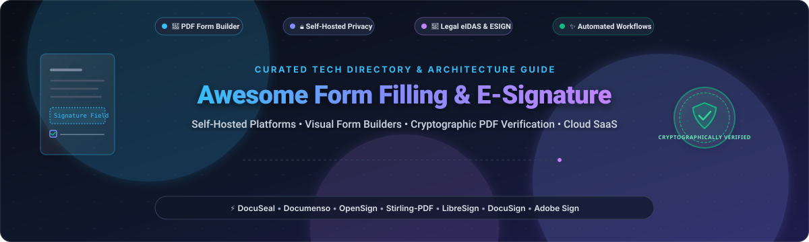

<div align="center">



# ✍️ Awesome Form Filling & E-Signature Tools Ecosystem 📑

[](https://github.com/ishandutta2007/Awesome-Awesome-Awesome)<a href="https://discord.gg/jc4xtF58Ve"></a>
<a href="https://github.com/ishandutta2007/Awesome-Form-Filling-E-Signature/stargazers"></a>
<a href="https://github.com/ishandutta2007/Awesome-Form-Filling-E-Signature/network/members"></a>
<a href="https://github.com/ishandutta2007/Awesome-Form-Filling-E-Signature/pulls"></a>
<a href="https://github.com/ishandutta2007/Awesome-Form-Filling-E-Signature/blob/main/LICENSE"></a>
<a href="https://github.com/ishandutta2007"></a>

<p align="center">
  <strong>Curated Directory of Open-Source DocuSign Alternatives, Self-Hosted Electronic Signature Platforms, Visual PDF Form Builders &amp; Enterprise SaaS Suites</strong><br>
  <em>Designed for developers, legal engineers, compliance officers, and IT teams prioritizing data sovereignty, cryptographic audit trails, and seamless document workflows.</em>
</p>

---

</div>

## 📑 Table of Contents
- [🔍 SEO &amp; Ecosystem Scope](#-seo--ecosystem-scope)
- [🌐 Sector Overview &amp; Market Dynamics](#-sector-overview--market-dynamics)
- [🏢 SaaS &amp; Hosted Platforms](#-saas--hosted-platforms)
  - [📊 SaaS Comparison Matrix](#-saas-comparison-matrix)
  - [🔍 Detailed SaaS Profiles](#-detailed-saas-profiles)
- [💻 Open-Source GitHub Projects](#-open-source-github-projects)
  - [🏆 Open-Source Rankings (Sorted by Stars)](#-open-source-rankings-sorted-by-stars)
  - [📦 Project Deep-Dives](#-project-deep-dives)
- [🔐 Legal &amp; Cryptographic Architecture Guide](#-legal--cryptographic-architecture-guide)
- [🤝 How to Contribute](#-how-to-contribute)
- [💖 Support &amp; Sponsorship](#-support--sponsorship)
- [⭐ Star History](#-star-history)
- [⚖️ Disclaimer](#️-disclaimer)

---

## 🔍 SEO & Ecosystem Scope

This directory curates software tools for **electronic signatures (e-signatures)**, **digital document signing**, **PDF form field population**, and **cryptographic verification**. Whether you need an off-the-shelf enterprise solution with broad compliance or a self-hosted, AGPL-licensed microservice to eliminate per-envelope SaaS fees, this list covers:

- **E-Signature & Digital Signature Platforms**: Legal signing conforming to ESIGN (US), UETA (US), and eIDAS (EU) regulations.
- **Visual PDF Form Builders**: WYSIWYG drag-and-drop tools for placing fillable inputs, checkboxes, signature fields, and date pickers.
- **Self-Hosted & Privacy-First Infrastructure**: On-premise Docker deployments ensuring sensitive contracts remain on your internal servers.
- **Cryptographic PDF Tools**: Libraries for PAdES, CAdES, XAdES standards, RFC 3161 timestamping, and X.509 digital certificates.

---

## 🌐 Sector Overview & Market Dynamics

- **Estimated Market Size**: The global electronic signature software market was valued at approximately **$5.5 billion in 2023** and is projected to surpass **$35.0 billion by 2030**, expanding at a compound annual growth rate (**CAGR of ~31.8%**). Growth is propelled by paperless enterprise transformation, automated remote onboarding, and legal parity mandates worldwide.
- **Market Dynamics & Concentration**: The commercial sector is **heavily concentrated at the top**, with legacy titans **Adobe** and **DocuSign** capturing an estimated ~65–70% of enterprise contract volume. However, the developer and SMB segments are experiencing **rapid fragmentation and unbundling**: recurring per-envelope charges, vendor lock-in, and stringent European data sovereignty (GDPR) mandates have triggered immense adoption of open-source, self-hosted alternatives like **DocuSeal**, **Documenso**, and **Stirling-PDF**.

---

## 🏢 SaaS & Hosted Platforms

### 📊 SaaS Comparison Matrix

The table below outlines leading commercial SaaS solutions, sorted in **descending order by company valuation / market capitalization / annual revenue**.

| 🏢 Platform | 💰 Company Valuation / Revenue | 🏷️ Starting Paid Pricing | 🎁 Free Tier / Trial Limits | 🔑 Key Capabilities | 🎯 Best For |
|:---|:---|:---|:---|:---|:---|
| **[Adobe Acrobat Sign](https://acrobat.adobe.com/us/en/sign.html)** | **$215B Market Cap**<br>*(~$21.4B Annual Revenue)* | **$12.99 / month**<br>*(Acrobat Standard, annual commitment; or $22.99 billed monthly)* | **Free Mobile App** (Adobe Fill & Sign) with unlimited basic signing;<br>**3 free web transactions / 30 days** on free Adobe ID;<br>**7-day free trial** of Acrobat Pro | Full native PDF editing, fillable form design, global eIDAS compliance, deep Microsoft 365 & Salesforce integration | Global enterprises embedded in Adobe and Microsoft ecosystems |
| **[DocuSign](https://www.docusign.com/)** | **$12.5B Market Cap**<br>*(~$2.8B Annual Revenue)* | **$10.00 / month**<br>*(Personal Plan, billed annually at $120/yr; or $15/mo monthly. Max 5 envelopes/mo)* | **Free Forever plan** to sign unlimited received documents;<br>**30-day free trial** with up to 100 envelope sends for evaluation | De facto global legal standard, comprehensive audit trails, 400+ turnkey CRM/ERP integrations, automated routing | Legal, corporate, and real estate enterprises needing recognized enforceability |
| **[Dropbox Sign](https://sign.dropbox.com/)**<br>*(formerly HelloSign)* | **$8.2B Market Cap**<br>*(~$2.55B Annual Revenue)* | **$15.00 / month**<br>*(Essentials, billed annually at $180/yr; or $20/mo monthly. 1 user, unlimited sends)* | **Free Forever plan**: 3 signature requests per month, 1 sender, tamper-proof audit trails;<br>**30-day free trial** of Essentials tier | Intuitive user interface, document status notifications, seamless integration with Dropbox, Google Drive, OneDrive | Small businesses, consultants, and teams looking for frictionless cloud signing |
| **[Zoho Sign](https://www.zoho.com/sign/)** | **~$8.0B Valuation**<br>*(Private; ~$1.4B Annual Revenue)* | **$10.00 / user / month**<br>*(Standard, billed annually at $120/yr; or $12/user/mo monthly. 25 docs/user/mo)* | **Free Forever plan**: 1 user, 3 document sends per month, multi-language support, audit trail;<br>**14-day free trial** of Enterprise tier | Native integration with Zoho One suite, blockchain timestamping, signer authentication via SMS/OTP | Organizations using Zoho CRM and companies prioritizing cost efficiency |
| **[SignNow](https://www.signnow.com/)**<br>*(airSlate)* | **$1.25B Valuation**<br>*(Series C Unicorn; ~$150M+ Revenue)* | **$8.00 / user / month**<br>*(Business, billed annually at $96/yr; or $20/user/mo monthly. Unlimited sends)* | **7-day free trial** with full access to unlimited document uploads, field configuration, and signature invites *(no free sending tier)* | Unlimited document sends on all tiers, reusable contract templates, mobile apps, conditional logic | Fast-growing SMBs needing high send volume at a competitive entry price |
| **[PandaDoc](https://www.pandadoc.com/)** | **$1.0B Valuation**<br>*(Series C Unicorn; ~$100M+ Revenue)* | **$19.00 / user / month**<br>*(Starter, billed annually at $228/yr; or $35/user/mo monthly. Unlimited sends)* | **Free eSign Plan (Free Forever)**: Unlimited legally binding signatures and document uploads;<br>**14-day free trial** of Business plan | Interactive proposal creation, CPQ quoting, embedded payment processing (Stripe, PayPal), CRM sync | Sales operations and revenue teams combining proposal authoring with e-signatures |
| **[OneSpan Sign](https://www.onespan.com/products/sign)** | **$620M Market Cap**<br>*(~$235M Annual Revenue)* | **$20.00 / user / month**<br>*(Professional, billed annually at $240/yr; unlimited document transactions)* | **30-day developer sandbox / trial** with up to 100 test document transactions, custom branding, and API access | High-assurance identity verification, digital certificates, white-labeling, audit trails with evidence summaries | Highly regulated financial institutions, insurance providers, and government agencies |
| **[Jotform Sign](https://www.jotform.com/products/sign/)** | **~$500M+ Valuation**<br>*(Bootstrapped; ~$100M+ Revenue)* | **$34.00 / month**<br>*(Bronze, billed annually at $408/yr; or $39/mo monthly. 250 signed docs/mo, 25 forms)* | **Starter Plan (Free Forever)**: 5 active forms, 100 form submissions/mo, 10 signed documents/mo, 100 MB storage | Dynamic web form builder combined with automated e-signature flows and PDF generation | Teams requiring complex web intake forms that automatically generate signed PDFs |

---

### 🔍 Detailed SaaS Profiles

#### 1. 🏢 Adobe Acrobat Sign
- **Company Profile**: Public flagship product of Adobe Inc. (NASDAQ: ADBE; Market Cap: ~$215B).
- **Core Strengths**: Unrivaled fidelity for ISO-standard PDF documents. Offers Adobe Sensei AI tools, automated field detection, enterprise-grade eIDAS Qualified Electronic Signature (QES) compliance, and deep hooks into Microsoft Power Automate, Teams, and Word.
- **Starting Price**: `$12.99/month` (annual Acrobat Standard plan).
- **Free Allowance**: Permanent free Adobe Fill & Sign mobile app; 3 free web transactions every 30 days via Adobe Cloud; 7-day full Acrobat Pro trial.
- **Honest Caveat**: Higher-end enterprise features (custom APIs, QES trust lists) require custom enterprise enterprise licensing tiers.

#### 2. ✒️ DocuSign
- **Company Profile**: The pioneer of cloud e-signatures (NASDAQ: DOCU; Market Cap: ~$12.5B).
- **Core Strengths**: Globally recognized legal standing in over 180 countries. Features pre-built connectors for Salesforce, SAP, Workday, and Google Workspace, alongside conditional fields, automated reminders, and bulk envelope delivery.
- **Starting Price**: `$10.00/month` (billed annually for Personal plan, capped at 5 envelopes/mo).
- **Free Allowance**: Free forever for signers receiving documents; 30-day trial with 100 envelope sends for senders.
- **Honest Caveat**: Per-envelope overage costs accumulate quickly for growing teams.

#### 3. 📦 Dropbox Sign (formerly HelloSign)
- **Company Profile**: Cloud productivity signature arm of Dropbox, Inc. (NASDAQ: DBX; Market Cap: ~$8.2B).
- **Core Strengths**: Exceptionally intuitive user experience, straightforward pricing with unlimited signature requests on individual plans, and tight integration with Dropbox folders, Google Drive, and OneDrive.
- **Starting Price**: `$15.00/month` (billed annually for Essentials single-user plan).
- **Free Allowance**: Free Forever tier granting 3 signature requests per month with complete audit logs; 30-day trial for paid tiers.
- **Honest Caveat**: Advanced workflow automation and multi-team admin controls require the more expensive Standard tier.

#### 4. ⚡ Zoho Sign
- **Company Profile**: Enterprise document component of Zoho Corporation's bootstrapped software cloud (Valuation: ~$8.0B+).
- **Core Strengths**: Seamless interoperability with Zoho CRM, Zoho Books, and Zoho People. Provides automated reminders, biometric signing on mobile devices, and tamper-proof verification via Ethereum blockchain hashing.
- **Starting Price**: `$10.00/user/month` (billed annually for Standard plan with 25 docs/user/mo).
- **Free Allowance**: Free Forever tier for 1 user with 3 document sends per month; 14-day free trial of Enterprise tier.
- **Honest Caveat**: The user interface is most cohesive when deployed alongside other Zoho business tools.

#### 5. 🚀 SignNow (airSlate)
- **Company Profile**: Document automation tool from airSlate Inc. (Valuation: ~$1.25B).
- **Core Strengths**: Unlimited document sending starting at the baseline tier. Reusable templates, mobile drawing signatures, KBA (knowledge-based authentication), and automated signature routing.
- **Starting Price**: `$8.00/user/month` (billed annually at $96/yr).
- **Free Allowance**: 7-day full-featured free trial with unlimited envelopes (no permanent free sending tier).
- **Honest Caveat**: Advanced integration options like Zapier and airSlate bots require enterprise upgrades.

#### 6. 🐼 PandaDoc
- **Company Profile**: Document workflow automation unicorn (Valuation: ~$1.0B).
- **Core Strengths**: Blends rich proposal design, interactive CPQ price tables, and e-signatures into one unified drag-and-drop workspace. Receives payments directly upon signature via Stripe, PayPal, or Square.
- **Starting Price**: `$19.00/user/month` (billed annually for Starter plan).
- **Free Allowance**: Free eSign Plan (Free Forever) with unlimited document uploads and legally binding e-signatures; 14-day free trial on Business.
- **Honest Caveat**: Template builder, custom branding, and CRM integrations are locked behind the $49/user/mo tier.

---

## 💻 Open-Source GitHub Projects

Below are the most prominent open-source repositories for electronic signatures, PDF form builders, digital signature engines, and document verification.

### 🏆 Open-Source Rankings (Sorted by Stars)

| Rank | Repository & Stars_Badge | License | Primary Tech Stack | Core Functionality |
|:---:|:---|:---:|:---:|:---|
| 1 | **[Stirling-PDF](https://github.com/Stirling-Tools/Stirling-PDF)** [](https://github.com/Stirling-Tools/Stirling-PDF/stargazers) | `GPL-3.0` | Java / Spring Boot / HTML | Swiss-army knife local PDF suite: interactive form filling, digital certificate signing, visual stamps, redaction |
| 2 | **[DocuSeal](https://github.com/docusealco/docuseal)** [](https://github.com/docusealco/docuseal/stargazers) | `AGPL-3.0` | Ruby / Rails / Vue.js | Open-source DocuSign alternative: WYSIWYG PDF form builder, AI field detection, multi-signer workflows, mobile-optimized |
| 3 | **[Documenso](https://github.com/documenso/documenso)** [](https://github.com/documenso/documenso/stargazers) | `AGPL-3.0` | TypeScript / Next.js / Prisma | The modern signing platform: PKCS#12 cryptographic PDF signing, RFC 3161 timestamps, sequential routing, custom branding |
| 4 | **[Formbricks](https://github.com/formbricks/formbricks)** [](https://github.com/formbricks/formbricks/stargazers) | `AGPL-3.0` | TypeScript / Next.js / Tailwind | Privacy-first modular form builder & survey suite with dynamic field qualification and self-hostable backend |
| 5 | **[OpenSign](https://github.com/OpenSignLabs/OpenSign)** [](https://github.com/OpenSignLabs/OpenSign/stargazers) | `AGPL-3.0` | Node.js / React / MongoDB | Free & open-source DocuSign alternative: template management, guest email OTP verification, audit trail certificates |
| 6 | **[Form.io](https://github.com/formio/formio)** [](https://github.com/formio/formio/stargazers) | `MIT` | JavaScript / Node.js | Enterprise combined drag-and-drop form builder, PDF form renderer, and complete RESTful JSON API schema server |
| 7 | **[CommonForms](https://github.com/jbarrow/commonforms)** [](https://github.com/jbarrow/commonforms/stargazers) | `Apache-2.0` | Python / PyTorch | Open-source computer vision models and dataset to automatically detect and segment fillable form fields in PDFs |
| 8 | **[PyPDFForm](https://github.com/chinapandaman/PyPDFForm)** [](https://github.com/chinapandaman/PyPDFForm/stargazers) | `MIT` | Python | Lightweight Python library and CLI to inspect, fill, draw, and stamp fillable PDF forms programmatically |
| 9 | **[Digital Signature Service (DSS)](https://github.com/esig/dss)** [](https://github.com/esig/dss/stargazers) | `LGPL-2.1` | Java | Official European Commission library for creating, extending, and validating eIDAS-compliant PAdES, CAdES, and XAdES |
| 10 | **[node-signpdf](https://github.com/vbuch/node-signpdf)** [](https://github.com/vbuch/node-signpdf/stargazers) | `MIT` | JavaScript / Node.js | Simple, low-level Node.js module to cryptographically sign PDFs with PKCS#7 / X.509 digital certificate byte ranges |
| 11 | **[LibreSign](https://github.com/LibreSign/libresign)** [](https://github.com/LibreSign/libresign/stargazers) | `AGPL-3.0` | PHP / Vue.js / Nextcloud | Nextcloud-integrated digital signature suite; recognized Digital Public Good supporting SES, AES, and QES workflows |
| 12 | **[pyHanko](https://github.com/MatthiasValvekens/pyHanko)** [](https://github.com/MatthiasValvekens/pyHanko/stargazers) | `MIT` | Python | Standards-compliant Python toolkit for signing, timestamping, and verifying PDF files (PAdES, CMS, PKCS#11 HSM) |
| 13 | **[SignServer CE](https://github.com/Keyfactor/signserver-ce)** [](https://github.com/Keyfactor/signserver-ce/stargazers) | `LGPL-2.1` | Java / Jakarta EE | Enterprise PKI server engine for automated, high-volume server-side document signing, PDF certification, and timestamps |

---

### 📦 Project Deep-Dives

#### 1. 🌟 [Stirling-PDF](https://github.com/Stirling-Tools/Stirling-PDF) [](https://github.com/Stirling-Tools/Stirling-PDF/stargazers)
- **Overview**: A robust, locally-hosted web application that handles virtually any PDF task without sending data to external third parties.
- **Form & Signing Features**: Supports filling out interactive PDF forms, adding visual signature stamps, applying digital signatures with `.p12` certificates, redacting sensitive text, and performing OCR.
- **Deployment**: Docker container (`docker run -p 8080:8080 frooodle/s-pdf:latest`).
- **Best For**: Internal team portals needing a self-hosted Swiss army knife for PDF editing, form filling, and signing.

#### 2. 🦭 [DocuSeal](https://github.com/docusealco/docuseal) [](https://github.com/docusealco/docuseal/stargazers)
- **Overview**: The most polished, complete open-source alternative to DocuSign. Offers an AGPL-3.0 licensed web app that deploys in minutes via Docker.
- **Form & Signing Features**:
  - WYSIWYG PDF form builder with 12 distinct field types (signature, initials, date, file upload, text, checkbox).
  - **AI-Powered Field Detection**: Automatically scans uploaded documents to suggest fillable coordinates.
  - Multi-party sequential signing flows and automated SMTP reminders.
  - Cryptographic PDF digital signature embedding with SHA-256 checksums and verification certificates.
  - Storage backends: Local disk, AWS S3, Google Cloud Storage, or Azure Blob.
- **⚠️ Honest Caveat**: The self-hosted edition generates a local signing certificate by default. Documents will show as valid locally, but will display an "unknown signer" warning in Adobe Reader until a CA-issued certificate is supplied.

#### 3. 🌐 [Documenso](https://github.com/documenso/documenso) [](https://github.com/documenso/documenso/stargazers)
- **Overview**: Built with TypeScript, Next.js, and Prisma, Documenso provides a developer-friendly architecture to replace legacy per-envelope signing vendors.
- **Form & Signing Features**:
  - Drag-and-drop signature field placement.
  - Multi-recipient signing flows with customizable sequential or parallel ordering.
  - Cryptographic PDF signing using a local `.p12` certificate with optional RFC 3161 timestamping authorities.
  - Comprehensive audit trail recording signer IP address, user agent, and timestamp.
  - White-labeling support and webhooks for CRM integration.
- **⚠️ Honest Caveat**: Like DocuSeal, relies on self-signed certificates out-of-the-box. Requires PostgreSQL setup for production.

#### 4. 🧱 [Formbricks](https://github.com/formbricks/formbricks) [](https://github.com/formbricks/formbricks/stargazers)
- **Overview**: Open-source survey and form software enabling granular user qualification, intake forms, and feedback workflows.
- **Form & Signing Features**: Visual form builder, customizable fields, conditional logic, and embedded widgets for web and mobile apps.
- **Best For**: User intake forms and qualification workflows prior to document execution.

#### 5. 🔓 [OpenSign](https://github.com/OpenSignLabs/OpenSign) [](https://github.com/OpenSignLabs/OpenSign/stargazers)
- **Overview**: Free, open-source e-signature platform offering document template creation, cloud drive integration, and guest signer verification.
- **Form & Signing Features**:
  - Multi-signer routing with sequential ordering.
  - Email One-Time Password (OTP) verification for external signers.
  - Audit trail with completion certificates.
  - Single-command Docker deployment.
- **⚠️ Honest Caveat**: Default container setup uses an ephemeral MongoDB instance that resets upon restart; an external MongoDB connection URI must be configured for persistent production storage.

#### 6. 🛠️ [Form.io](https://github.com/formio/formio) [](https://github.com/formio/formio/stargazers)
- **Overview**: Combined drag-and-drop form builder and REST API data engine for enterprise web applications.
- **Form & Signing Features**: Generates dynamic JSON-driven forms, renders existing PDF forms for web completion, and manages submissions securely.
- **Best For**: Developers building custom portals requiring complex multi-page forms with PDF generation.

#### 7. 🤖 [CommonForms](https://github.com/jbarrow/commonforms) [](https://github.com/jbarrow/commonforms/stargazers)
- **Overview**: Open-source machine learning models specifically designed to solve the document understanding challenge: locating where fields should be in flat PDFs.
- **Features**: Identifies bounding boxes for text inputs, check boxes, and signature blocks automatically.
- **Best For**: Engineers building AI-assisted document ingestion pipelines.

#### 8. 🐍 [PyPDFForm](https://github.com/chinapandaman/PyPDFForm) [](https://github.com/chinapandaman/PyPDFForm/stargazers)
- **Overview**: Fast, dependency-light Python library and CLI tool built specifically for fillable PDF forms.
- **Features**: Read field schemas, inject text and image signatures, and flatten AcroForms into static documents.
- **Best For**: Python backends automating batch contract generation.

#### 9. 🏛️ [Digital Signature Service (DSS)](https://github.com/esig/dss) [](https://github.com/esig/dss/stargazers)
- **Overview**: Reference implementation maintained by the European Commission for handling eIDAS-compliant advanced electronic signatures.
- **Features**: Supports PAdES, CAdES, and XAdES formats, validation of Qualified Certificates, and CRL/OCSP revocation checks.
- **Best For**: European enterprise and government projects requiring formal legal conformance.

#### 10. 📜 [node-signpdf](https://github.com/vbuch/node-signpdf) [](https://github.com/vbuch/node-signpdf/stargazers)
- **Overview**: High-speed Node.js utility for applying digital signatures to PDF documents.
- **Features**: Injects PKCS#7 detached signatures without altering document layout or visual layers.
- **Best For**: JavaScript/TypeScript microservices needing low-level cryptographic signing capabilities.

#### 11. ☁️ [LibreSign](https://github.com/LibreSign/libresign) [](https://github.com/LibreSign/libresign/stargazers)
- **Overview**: Open-source e-signature platform built directly as a Nextcloud application; recognized as a Digital Public Good.
- **Features**: Supports SES, AES, and QES workflows with cryptographic hashes and external guest signing links.
- **⚠️ Honest Caveat**: Requires an operational Nextcloud deployment to function; cannot run as a standalone service.

#### 12. 🔏 [pyHanko](https://github.com/MatthiasValvekens/pyHanko) [](https://github.com/MatthiasValvekens/pyHanko/stargazers)
- **Overview**: Comprehensive Python library and CLI for cryptographically signing, certifying, timestamping, and verifying PDF files.
- **Features**: Implements PAdES baseline signatures, RFC 3161 timestamps, and integrates with hardware tokens (PKCS#11 HSMs).
- **Best For**: Security engineers needing cryptographically strict PDF verification.

#### 13. 🛡️ [SignServer CE](https://github.com/Keyfactor/signserver-ce) [](https://github.com/Keyfactor/signserver-ce/stargazers)
- **Overview**: Open-source PKI signing engine built by Keyfactor (creators of EJBCA).
- **Features**: Centralized server-side signing of documents, PDFs, code, and timestamps using hardware or software keys.
- **Best For**: Centralized enterprise PKI environments requiring audited digital signing keys.

---

## 🔐 Legal & Cryptographic Architecture Guide

When deploying self-hosted electronic signature and form-filling software, consider these critical technical and compliance factors:

```
+-----------------------------------------------------------------------------------+
|                            eIDAS SIGNATURE LEVELS                                 |
+-----------------------------------------------------------------------------------+
| 1. SES (Simple Electronic Signature)                                              |
|    - Typed name, drawn scribble, clicked checkbox.                                |
|    - Enforceability depends heavily on evidentiary audit trails (IP, email, time).|
+-----------------------------------------------------------------------------------+
| 2. AES (Advanced Electronic Signature)                                            |
|    - Uniquely linked to the signer, capable of identifying the signer.            |
|    - Created using signature creation data under signer's sole control.           |
|    - Tamper-evident: any subsequent alteration of the signed data is detectable.  |
+-----------------------------------------------------------------------------------+
| 3. QES (Qualified Electronic Signature)                                           |
|    - Highest standard under EU eIDAS regulation (legal equivalent to wet ink).    |
|    - Requires a Qualified Certificate from a Trust Service Provider (QTSP) and    |
|      a Qualified Signature Creation Device (QSCD/HSM).                            |
+-----------------------------------------------------------------------------------+
```

### 🔑 Certificate Management & Adobe Reader "Green Checkmark"
- **The Self-Signed Trap**: Open-source tools (DocuSeal, Documenso) generate self-signed X.509 certificates out-of-the-box. While legally valid under US ESIGN/UETA with proper consent and audit trails, opening the PDF in Adobe Acrobat Reader displays an *"At least one signature has problems"* warning because the root certificate is not in Adobe's Approved Trust List (AATL).
- **The Fix**: To achieve the native green verification badge in Adobe Reader, configure your self-hosted instance with a digital certificate issued by an **AATL-accredited certificate authority** or install your corporate CA cert into employees' trust stores.

---

## 🤝 How to Contribute

We welcome additions, updates, and architectural tips from the community!

1. **Fork the repository** to your GitHub account.
2. **Add or update an entry** in `README.md` following the established table or project structure.
3. **Include essential details**:
   - Platform name & official URL
   - Whether it is commercial SaaS or open-source
   - Specific pricing tiers and explicit free trial / free tier terms (no generic placeholders)
   - Accurate license and Stars_Count badge (linked to stargazers)
4. **Submit a Pull Request** with a concise description of your changes.

---

## 💖 Support & Sponsorship

Thank you for exploring this ecosystem! If you find this directory valuable for your document automation, e-signature implementations, or self-hosted workflows, please consider supporting the project:

- ⭐ **Star** this repository on GitHub to increase visibility and help others discover it.
- 🍴 **Fork** and contribute new tools, updates, and benchmarks.
- 📢 **Share** with your engineering, legal operations, IT, and security teams.
- ☕ **Buy Me a Coffee**: Support ongoing open-source curation and maintenance via the [GitHub Sponsor Dashboard](https://github.com/sponsors/ishandutta2007).

Thank you for supporting open-source software and open document standards! 🙏

---

## ⭐ Star History

[](https://star-history.dera.page/#ishandutta2007/Awesome-Form-Filling-E-Signature&type=date&legend=topeleft)

---

## ⚖️ Disclaimer

- This repository is a **community-curated index** provided for educational and architectural reference only. It does not constitute legal or regulatory advice.
- E-signature enforceability and compliance requirements vary by jurisdiction, contract type, and industry. Always consult qualified legal counsel regarding ESIGN, UETA, eIDAS, HIPAA, or 21 CFR Part 11 requirements.
- Self-hosted open-source software requires dedicated database backups, SSL certificate maintenance, and secure key storage.

---

<div align="center">

**Made with ❤️ for legal teams, security engineers, sales operations, and developers.**<br>
*Let's make form filling and document signing open, auditable, and cost-effective.*

</div>
